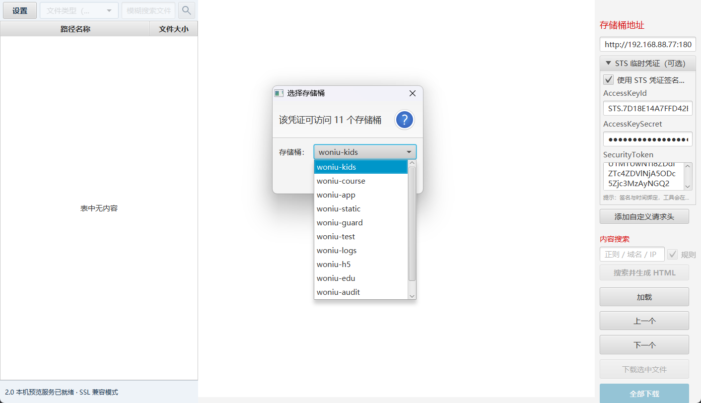
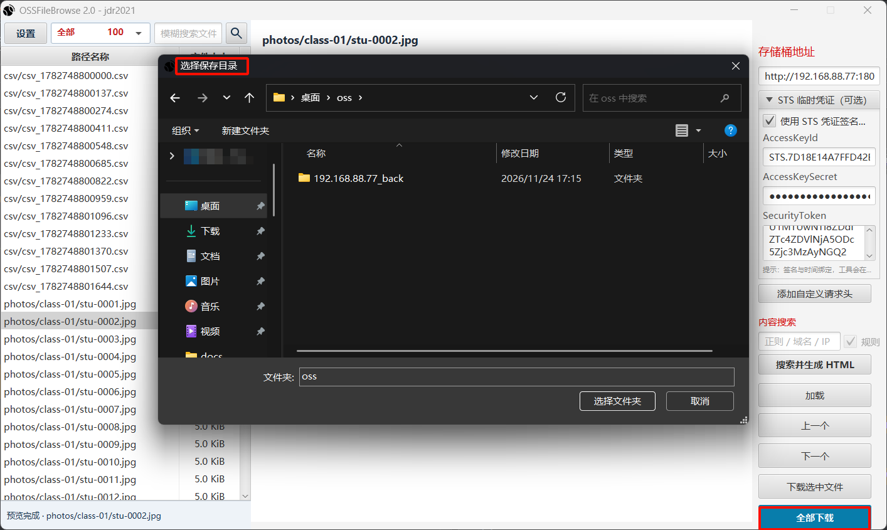
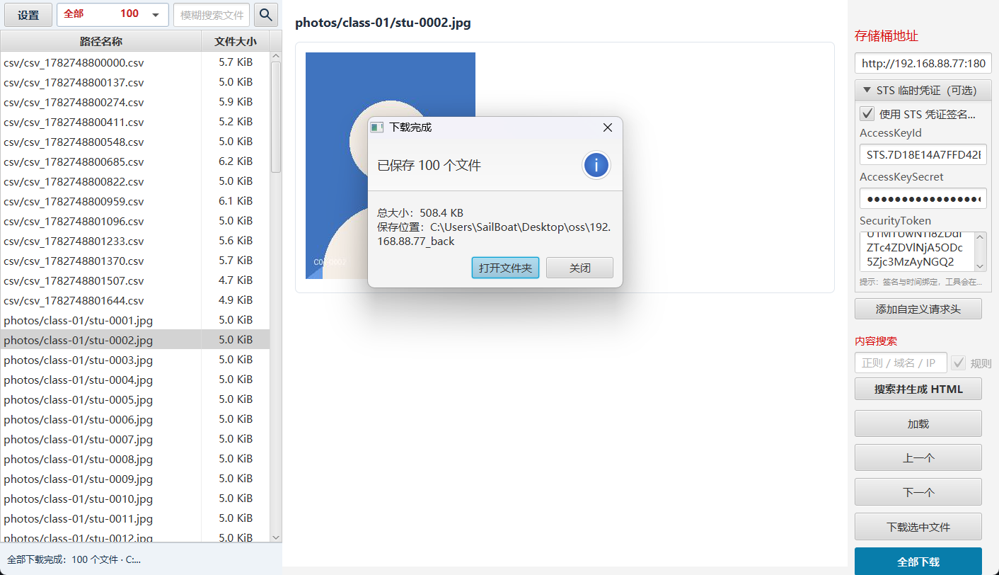

# OSSFileBrowse-Enhanced

阿里云 OSS 存储桶遍历与文件预览工具，支持 STS 临时凭证。

由于经常遇到存储桶遍历漏洞，直接访问文件是下载，不方便预览，且甲方要求证明该存储桶的危害，因此该工具应运而生。

> **本仓库是基于 [jdr2021/OSSFileBrowse](https://github.com/jdr2021/OSSFileBrowse) 的增强版**
>
> 在原版基础上新增：
>
> - 支持阿里云 **STS 临时凭证**（AccessKeyId / AccessKeySecret / SecurityToken）
> - 可按**服务端点**直接 ListBuckets 列出全部存储桶
> - 批量下载可选择保存目录，完成后弹窗提示
> - 修复中文等非 ASCII 对象名签名失败（403）的问题
>
> 原版功能全部保留，未启用 STS 时行为与原版一致。

# 下载

从 [Releases](https://github.com/PLANETDUST/OSSFileBrowse-Enhanced/releases) 下载最新版可执行 jar：

| 文件 | 说明 |
|---|---|
| `OSSFileBrowse-2.1-windows-x86_64.jar` | Windows 版，需 Java 17+ |

启动方式：

```bash
java -jar OSSFileBrowse-2.1-windows-x86_64.jar
```

# 使用

1. 在「存储桶地址」填入目标地址，支持三种写法：

```text
https://bucket.oss-cn-hangzhou.aliyuncs.com/
https://oss-cn-hangzhou.aliyuncs.com/oss/bucket
https://oss-cn-hangzhou.aliyuncs.com/
```

2. 若目标使用 STS 临时凭证，展开右侧「STS 临时凭证」面板并填入三要素
3. 点「加载」

填服务端点（无桶名）时，工具会先调用 ListBuckets 列出可用存储桶供选择。

详细说明见 [STS-SUPPORT.md](./STS-SUPPORT.md)。

# 更新日志

## 2026.11.24 v2.1 增强版

1. 支持阿里云 STS 临时凭证。右侧新增「STS 临时凭证」面板，填入三要素即可浏览存储桶；签名改为每次请求按「当前时间 + 目标路径」实时计算，解决翻页、预览、切换对象时的 `SignatureDoesNotMatch`；

   

2. 支持直接填写服务端点（如 `https://oss-cn-hangzhou.aliyuncs.com/`），工具先调用 ListBuckets 列出该凭证可访问的存储桶，弹窗选择后再进入浏览；

   

3. 修复非 ASCII 对象名（如 `中班-01-语言.pptx`）签名失败的问题：签名使用解码后的原始路径，URL 编码仅用于传输；

4. 「全部下载」支持自选保存目录，完成后弹窗显示文件数量、总大小与保存路径，并可一键打开文件夹；

   

5. 选中文件下载完成后，同样弹出提示框并可定位到文件所在位置。

   

# 构建

```bash
mvn clean package
```

产物在 `target/OSSFileBrowse-2.1-windows-x86_64.jar`。

# 来源说明

本项目的全部基础功能来自 [jdr2021/OSSFileBrowse](https://github.com/jdr2021/OSSFileBrowse)，原作者为 jdr2021。

本仓库在其 2.0 版本基础上做二次开发，新增 STS 临时凭证支持等功能。上游项目未附带 LICENSE 文件，本仓库同样不附加额外授权条款，使用前请自行评估合规性。

# 最后

如果该项目对你有帮助，给一个小小的`star`吧。
